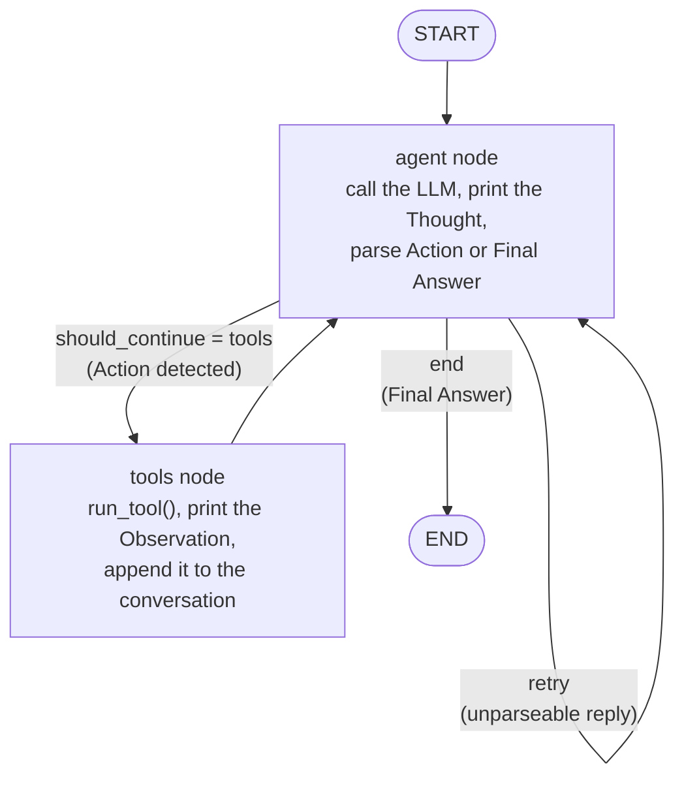

# 🧭 Bridgeway – Custom ReAct Agent with Configurable Personas

**EECE 503P – C4: Build a Custom ReAct Agent with Configurable Personas**

An assistant for *Bridgeway – Fundraising & Communications Consultancy for NGOs*, a fictional agency in Hamra, Beirut,
that helps Lebanese NGOs reach donors, partners and volunteers. It continues my C3 project: the business documents
and the lead/feedback tools are reused, but the assistant is now a **ReAct agent** built by hand in **LangGraph**,
with two **personas** that each have their own prompt traits and LLM configuration, a separate **Instructions** block,
and logged **experiments** comparing prompting strategies.

Main deliverable: **[`c4_react_agent.ipynb`](c4_react_agent.ipynb)**, readable top to bottom.

## Use case

- **Agent goal:** answer questions about Bridgeway's services, process, team, hours and prices from the business documents; quote a campaign package with the one applicable discount; record leads and feedback; and point interested NGOs to the free 30-minute discovery call.
- **Target audience:** staff and volunteers of Lebanese NGOs who want to reach donors, partners or volunteers, plus visitors with general questions about Bridgeway. Users may write in English, Arabic or French.
- **Tools:**
  - `search_business_info(query)` - keyword search over the business documents.
  - `record_customer_interest(email, name, message)` - saves a lead when a person leaves a name and email.
  - `record_feedback(question)` - saves unknown or out-of-scope requests, praise and complaints.
  - `estimate_campaign_package(ngo_size, goal)` - prices a package from `business_data.py` with the single applicable discount.
- **Constraints and limitations:** every fact and price must come from a tool result, never from memory; the agent never promises how much money a campaign will raise; it declines what Bridgeway does not do (full grant proposals, buying or selling email lists, paid ads, handling or collecting donation money, outreach for political parties or for-profit companies); discounts never stack; one Action per turn and at most 6 LLM calls per question; the free Gemini tier limits requests per minute and per day, and its OpenAI-compatible endpoint rejects `top_k` and the penalty settings.

## How the manual ReAct loop works

ReAct = **Thought → Action → Observation → … → Final Answer**. No `AgentExecutor`, no `create_react_agent`,
no prebuilt `ToolNode`: the loop is two hand-written LangGraph nodes and one conditional edge.



1. The system prompt teaches the model a text protocol: either
   `Thought:` + `Action:` + `Action Input: {json}`, or `Thought:` + `Final Answer:`.
2. The **agent node** calls the LLM with `stop=["Observation:"]`, so the model can never invent a tool result.
   Our own parser, `parse_model_output()`, decides whether the reply is an action, a final answer or malformed.
3. The conditional edge **`should_continue`** routes to `tools`, back to `agent` (retry), or to `END`.
4. The **tools node** runs the tool through `run_tool()` (never raises; bad input becomes `{"status": "error", ...}`),
   and sends the result back as `Observation: {...}`.
5. `MAX_STEPS = 6` stops runaway loops. The LLM configuration travels inside the graph state, so one compiled graph
   serves both personas and every experiment.

Every Thought / Action / Observation is printed while the agent runs.

## Personas

Each persona = **prompt traits** (tone, vocabulary, response style, values) **+ a matching LLM configuration**.

| Setting | Layla – warm partnerships advisor | Dr. Karam – strict grant compliance expert |
|---|---|---|
| temperature | 0.8 – varied, natural phrasing so the warmth does not sound scripted | 0.1 – figures and rules repeated exactly as retrieved |
| top_p | 0.95 – wide word choice for a conversational tone | 0.8 – only the most probable wording |
| top_k | 50 – variety, but filters odd words | 20 – narrow, formal, consistent vocabulary |
| max_tokens | 800 – room for a follow-up question and a next step | 500 – forces concise, list-style answers |
| frequency_penalty | 0.3 – avoids repeating the same friendly phrases | 0.0 – repeating exact terms is desirable in compliance |
| presence_penalty | 0.2 – nudges her to add a next step | 0.0 – stays on the asked topic |
| thinking_budget | 0 – no hidden reasoning; the visible Thought is the whole chain of thought | 0 – every reasoning step is visible and auditable |

Settings the provider does not accept (Gemini's OpenAI-compatible endpoint rejects `top_k` and the penalties) are
dropped automatically by `call_llm()` and listed in `UNSUPPORTED_PARAMS`.

The **Instructions** block is separate from the personas (persona = *how to talk*, instructions = *what to do*):
input/output format, ten numbered rules with one purpose each, and a full worked example.

## Tools

| Tool | When the agent calls it | What it does |
|---|---|---|
| `search_business_info(query)` | any factual question about Bridgeway | keyword search over `me/business_summary.txt` and `me/about_business.pdf` |
| `record_customer_interest(email, name, message)` | a person gives a name + email and wants a service | validates and saves the lead to `logs/leads.jsonl` |
| `record_feedback(question)` | unknown or out-of-scope requests, praise, complaints | saves to `logs/feedback.jsonl` |
| `estimate_campaign_package(ngo_size, goal)` | cost, quote or budget questions | price from `business_data.py` with the single applicable discount (20% small NGO / 10% for 2+ services, never stacked) |

The tool descriptions (`tools.MCP_TOOL_DEFINITIONS`) are rendered into the system prompt by `describe_tools()`.

## Experiments

Five fixed test questions (fact lookup, price estimate, lead with contact info, out of scope, missing info) are run
through both personas under seven experiments:

1. with vs. without Chain-of-Thought
2. few-shot vs. zero-shot (worked example kept / dropped)
3. instructions in the system prompt vs. in the user message
4. low (0.1) vs. high (1.0) temperature
5. model type: the five questions with Layla's config on a second Gemini model
6. max_tokens 150 vs 800
7. top_p 0.5 vs 1.0

Every run is logged to [`logs/experiments.csv`](logs/experiments.csv) (persona, experiment, setup, config, question,
tools used, steps, correct tool use Y/N, hallucination Y/N, answer, notes) and compared in a pandas table.

### Results

121 runs, 116 on the free `gemini-3.5-flash-lite` plus 5 model-type runs on `gemini-3.1-flash-lite` (5 questions × 2 personas per setup;
per setup: correct tool use / hallucinations / complete answers, out of 10, and average LLM calls). The daily quota ran out at run 117 of 120,
so 4 of Dr. Karam's top_p 1.0 runs are missing; the resumable runner adds them on the next run.

| Experiment | Setup A | Setup B | Best setup | Key observation |
|---|---|---|---|---|
| 1. Chain-of-Thought | with CoT: 10 / 0 / 9, 1.8 steps | without CoT: 10 / 0 / 10, 2.5 steps | mixed: with CoT used fewer steps (1.8 vs 2.5), without CoT had one more complete answer | Same tool use; without the Thought line the agent needed more steps and 2 of the 3 tool errors happened there |
| 2. Shots | few-shot: 10 / 0 / 9, 1.8 steps | zero-shot: 10 / 0 / 9, 1.9 steps | tie | The worked example made no measurable difference |
| 3. Instruction placement | system prompt: 10 / 0 / 9, 1.8 steps | user message: 10 / 0 / 10, 2.0 steps | tie | One run apart; the system prompt used slightly fewer steps |
| 4. Sampling config | temperature 0.1: 10 / 0 / 10, 1.8 steps | temperature 1.0: 10 / 0 / 10, 1.8 steps | tie | Temperature made no measurable difference on these questions |
| 5. Model type | `gemini-3.5-flash-lite`, Layla, 5 questions: 5 / 0 / 4, 1.8 steps | `gemini-3.1-flash-lite`, same config: 4 / 0 / 3, 1.6 steps | newer model | The older model skipped `record_customer_interest` on the lead question and asked for the budget instead of the email |
| 6. Max tokens | 150: 10 / 1 / 7, 1.9 steps | 800: 10 / 0 / 10, 1.8 steps | 800 | Dr. Karam's list-style answers were cut off mid-sentence at 150 tokens (2 of 5 complete); Layla's short replies still fit (5 of 5). The one "hallucination" is a scorer false positive on a correct "out of scope" refusal |
| 7. Top-p | 0.5: 10 / 0 / 10, 1.8 steps | 1.0: 6 / 0 / 6, 1.8 steps (4 runs missing, quota) | tie | No measurable difference on the runs that completed |

- **Personas:** correct tool use 100% for Dr. Karam and 98% for Layla; complete answers 93% and 92%. Dr. Karam's only failures came with max_tokens 150.
- **Weakest case:** the missing-info question (no email given) was answered fully in 75% of runs; the agent often
  asked for the NGO's budget instead of the email.
- **Instructions block:** for the same price question, both personas used `search_business_info` without it and
  `estimate_campaign_package` with it (notebook sections 8–9).
- Gemini's endpoint rejected `top_k`, `frequency_penalty`, `presence_penalty` and `thinking_budget`, so the personas
  differed in practice by prompt, temperature, top_p and max_tokens.
- Hallucination here is an automatic check (figures not in the documents or tool results, or a missing refusal);
  it flagged one run, a false positive on a correct refusal. With 5 runs per persona and setup, these are indications rather than proof.

Full log: [`logs/experiments.csv`](logs/experiments.csv). Reflection: notebook section 11.

## Setup

Requires Python 3.10+. On Windows use `py`, on macOS/Linux `python3`.

```bash
py -m venv venv
venv\Scripts\activate            # macOS/Linux: source venv/bin/activate
pip install -r requirements.txt
copy .env.example .env           # macOS/Linux: cp .env.example .env
```

Then put your key in `.env` (never committed):

```ini
LLM_PROVIDER=gemini              # or: openai
GEMINI_API_KEY=...               # or OPENAI_API_KEY=...
# LLM_MODEL=                     # optional: default gemini-3.5-flash-lite / gpt-4o-mini
```

## Run

Open `c4_react_agent.ipynb`, select the `venv` kernel and run all cells.

| Section | What happens |
|---|---|
| 6–9 | ReAct runs with printed Thought / Action / Observation, the four tools, the two personas, the Instructions block |
| 10 | `run_all_experiments()` – about 100 model runs; use `run_all_experiments(delay_s=6)` on a rate-limited free tier |
| 11 | Reflection, with helper cells that print the numbers from `logs/experiments.csv` |
| 12 | Gradio chat with a persona dropdown and an optional reasoning trace (`demo.launch()`) |

## Files

| File | What it is |
|---|---|
| `c4_react_agent.ipynb` | **Main deliverable** (C4) |
| `tools.py` | The four tools, MCP-style definitions, `run_tool()` |
| `business_data.py` | Prices and discount rules (single source of truth, used by `estimate_campaign_package`) |
| `knowledge.py` | Loads the business summary and PDF text |
| `llm.py` | Creates the LLM client from `.env` |
| `log_utils.py` | Shared JSONL logging helpers |
| `me/business_summary.txt`, `me/about_business.pdf` | The business in two formats (PDF built by `make_pdf.py`) |
| `logs/experiments.csv` | Experiment results |
| `business_agent.ipynb`, `app.py`, `agent.py`, `router.py`, `reflection.py`, `tests/` | The C3 assistant this project builds on (kept for reference; `py -m pytest` runs its tests) |
